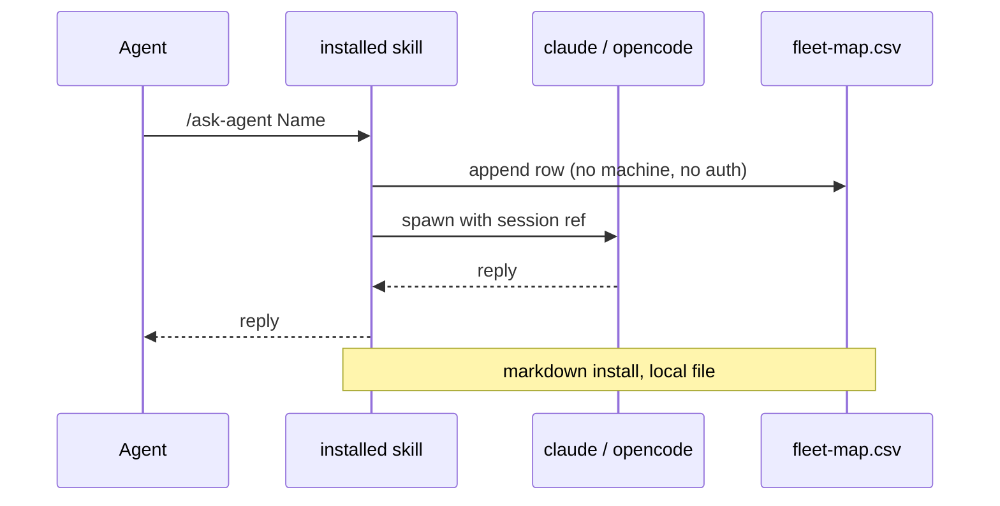
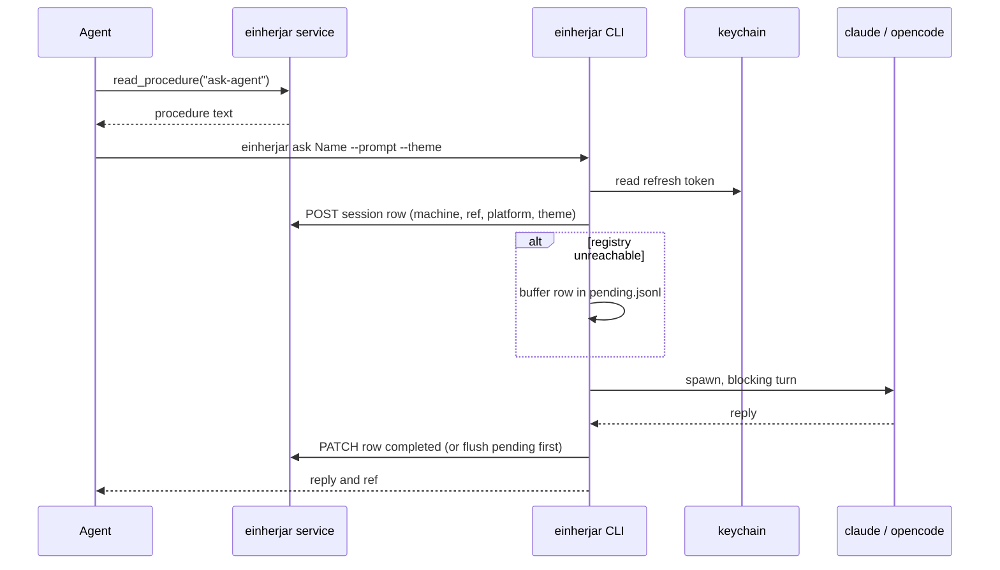
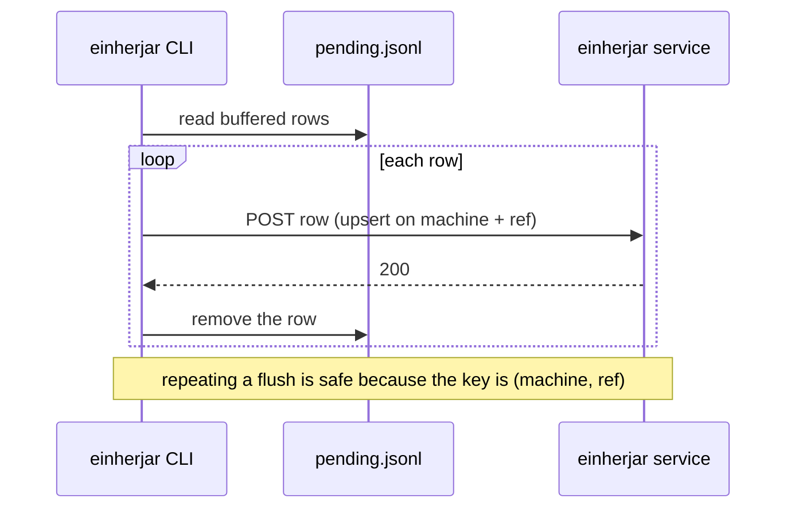

# High Wizard Plan

## **PROJECT INFO**
- **Project**: agent-memory-fleet
- **Date**: 2026-10-20
- **Agent**: Claude Admiral
- **Theme**: Einherjar: the fleet registry, its CLI, and the roster seam
- **Source Protocol**: `/high-wizard` — /high-wizard

*CRITICAL INSTRUCTION: To continue this plan: load the source protocol above, then inspect which sections below are filled vs unfilled to infer your current step.*

---

## **INHERITED CONTEXT**
*Filled at investigation step 0 with whatever was settled before this plan existed. The two sources are recorded separately and never merged — write "None" under a part that does not apply.*
*These decisions are **not yours to reopen**. If one looks wrong, STOP and surface it to [USER-NAME] — do not silently re-decide it here or in Confirmed Decisions below.*

### From the Parent Plan
- **Parent plan**: None — not a sub-plan
- **Assigned scope**: None — no parent assigned a boundary; the scope is this plan's own first round

| # | Inherited decision | Chosen | Parent's reason | Status |
|---|--------------------|--------|-----------------|--------|
| 1 | None | — | — | — |

- **Integration contracts**: None
- **Pushed-down open items**: None

### From Pre-Planning Discussion
- **Discussion**: Pre-planning discussion with Alvi, 2026-10-20
- **Agreed scope**: continue the agent-memory-fleet / hermod-fleet project; make the fleet usable from OpenCode as well as Claude Code; chase a fleet that any AI coding platform can use

| # | Settled decision | Chosen | His reason | Status |
|---|------------------|--------|------------|--------|
| 1 | Supported platforms | Claude Code and OpenCode, no others for now | "with only those 2 in mind" — a third platform is a future case, not a design driver | Settled |
| 2 | Transport shape | Patch the existing fleet scripts; no new runtime and no server | "we still need specific platform (opencode, claude) ... we need to modify these scripts" | Superseded by 6 |
| 3 | Session identity | Store the platform ref separately from the fleet's own identity | OpenCode session ids must match `^ses`, so a UUID-shaped map column cannot carry them | Settled |
| 4 | Delivery layer | Not settled — this plan's subject | "I want to know how it works in Claude / Opencode locally", then "use /hermod:high-wizard" for the delivery layer | Superseded by 6 |
| 5 | Roster storage | Not settled | The fleet still reads `shared-memory/[project]/fleet-agents.md` by path, which an mcp-only machine does not have | Settled by 7 |
| 6 | Layer delivery | Served only; markdown retires | "the plan is for the local markdown will be removed entirely, so there's no local markdown anymore" (2026-10-21); `agent-memory-doc` and `heimdall-map` follow the same move | Settled |
| 7 | Memory store | Munnin only; the `@agent-memory` file backend retires | "the memory store is Munnin only" (2026-10-21); the data is in Valaskjalf | Settled |

- **Considered and rejected**: a `claude` shim that secretly calls `opencode` (the flags differ, so the shim is the adapter in disguise) · a hosted MCP tool that spawns agents (a tool executes on the server, so it would spawn on the wrong machine)
- **Left open**: None. Decisions 6 and 7 closed delivery and the store; the plan's own rounds closed scope, storage, auth and deployment.

---

## **OBJECTIVES**
Deliver **Einherjar**: the fleet's served layer and hosted registry, plus the CLI that runs a consult on either supported harness. Procedures arrive over MCP, sessions record themselves centrally, a registry outage never blocks a consult, and nothing depends on an installed markdown layer or a checked-out memory store.

### **Related Documents**
- [ADR-001: The fleet transport contract](../docs/adr/2026-10-21-fleet-transport-contract.md) - Why a session ref and a fleet identity are separate facts, and where execution lives
- [ADR-002: The fleet data boundary](../docs/adr/2026-10-21-fleet-data-boundary.md) - Why the roster stays in the memory store and sessions live in Einherjar
- [ADR-003: The fleet layer is served, not installed](../docs/adr/2026-10-21-fleet-served-layer.md) - Why the procedures arrive over MCP and the installed form is retired

### **SUCCESS CRITERIA**
- [ ] `setup-fleet` and `load-fleet` read and write one Munnin `knowledge` record; no file form exists, and the overlay's roster pointer fires in the project.
- [ ] A harness with no fleet clone reads all four procedures through `read_procedure` and both templates as resources; the served text equals the compiled text byte for byte.
- [ ] `einherjar install` removes previously installed fleet skills and registers the MCP server, leaving no fleet skill behind.
- [ ] `einherjar login` completes loopback PKCE once per machine and stores a refresh token in the OS keychain; later calls need no browser.
- [ ] A consult on Claude Code and on OpenCode writes a session row keyed by `(user_id, machine, ref)`, spawns locally, and patches the row to completed or failed.
- [ ] With the registry unreachable, the consult still runs; the row buffers locally and flushes on the next successful call.
- [ ] Two signed-in users cannot see each other's rows, including sessions on a machine with the same name and ref.
- [ ] A missing CLI is reported by the installer before a consult, not halfway through one.
- [ ] The service runs at `einherjar.lok.quest` behind Logto, health green, token audience matching the registered resource.
- [ ] `einherjar-deploy` pins the service and can roll back without Hermod or Munnin.
- [ ] Tests cover transport parity, token refresh, the API contract, the migration, and the pending flush; CI green.
- [ ] Three ADRs: the transport contract, the fleet data boundary, and the served-only layer.

---

## **SCOPE**

### In Scope
- **Roster access**: `setup-fleet` and `load-fleet` read and write one Munnin `knowledge` record, so the overlay's pointer fires and no file form exists.
- **Content face**: Einherjar serves the four procedures as prompts and through a `read_procedure` tool, and the templates as resources, from the fleet repo pinned as a submodule.
- **Local setup**: `einherjar install` registers the MCP server and removes the skills the markdown installer left.
- **`einherjar-server`**: a typed `fleet_session` table with its own migrations; HTTP write endpoints; read-only MCP registry tools; the Logto verifier and tenant resolution.
- **The CLI**: both transport adapters, `login`, token refresh, the machine identity, the pending buffer and the commands.
- **`einherjar-deploy` and the instance**: the service definition, the DSN secret, the proxy host at `einherjar.lok.quest`, and the Logto registrations.
- **The three ADRs** and the documentation updates that make the boundary legible.

### Out of Scope
- **A markdown fallback**: the installed-skill path is removed, not kept behind a flag; `[FLEET-ACCESS]` becomes `mcp`.
- **The memory core's file-backend retirement itself**: that belongs to the core; this plan only stops depending on it.
- **Remote execution across machines**: a row names where a session lives; it never becomes a way to drive another machine.
- **Surfacing other machines' rows in the everyday roster**: decided against for now, so the roster stays quiet.
- **A third platform**: the adapter is two branches, and a third is a later addition.
- **A roster shared between users**: each user's roster is their own, as Munnin's rows already are.

---

## **CONFIRMED DECISIONS**
*Decisions made **by this plan** — both **asked-and-confirmed** by [USER-NAME] AND **written-through** (Zone A and B decisions made by the agent, recorded with their reasoning). The reasons serve as the analysis record.*
*Decisions settled before this plan existed — by a parent, or in a pre-planning discussion — belong in [INHERITED CONTEXT](#inherited-context) above, not here. Keeping them separate is what shows which decisions this plan actually owns.*

| # | Decision | Chosen | Reason |
|---|----------|--------|--------|
| 1 | Scope | Served layer plus hosted registry | The transport is proven; delivery moves to MCP, and central visibility was chosen over a local-only map |
| 2 | Registry failure posture | Proceed, warn, buffer the row, flush later | The registry is visibility, not the resume authority, so it must not stop work |
| 3 | Sign-in moment | Lazy on first call plus `einherjar login` | One-time and self-explaining; an explicit-only rule makes a fresh machine look broken |
| 4 | Row visibility | Not surfaced in the everyday roster; the registry view still lists them | The roster answers "who can I consult", not "what is running where"; a foreign row is noise there but useful in the registry |
| 5 | Token scope | Per machine | Matches the keychain and the machine-bound ref |
| 6 | Service boundary | Separate `einherjar-server` | It owns its schema and migrations, keeping Hermod's no-DDL rule intact |
| 7 | Session storage | New `fleet_session` table defined and migrated in `einherjar-server`, key `(user_id, machine, ref)` | Indexed and concurrency-safe; the identity carries every axis; the migration lives with the service, so Munnin's schema never carries fleet rows |
| 8 | Roster storage | Munnin `knowledge` row | The overlay pointer reads the context index, and the knowledge gates apply |
| 9 | CLI auth flow | Loopback PKCE | A laptop with a browser; device code is the fallback if Logto does not grant it |
| 10 | Client home | `einherjar-server`, installed as a CLI | One source of truth for the protocol, at the cost of an install step |
| 11 | Deploy home | `einherjar-deploy`, `einherjar.lok.quest` | Independent release and rollback, following the family pattern |
| 12 | Interface | HTTP writes; MCP serves content and read-only registry tools | The CLI is the only writer; the MCP face is how a procedure and a row are read |

---

## **SOLUTION**

### Architecture Overview

Einherjar is three artifacts and two stores. **agent-memory-fleet** is content now: the four procedures and their templates, validated by CI, served rather than installed. **einherjar-server** vendors that repo as a content submodule and holds the two halves of the capability: the hosted registry and the content face, plus the CLI that runs on the user's machine. **einherjar-deploy** holds the instance. Munnin keeps the roster, because the coding overlay's pointer reads its context index, and Logto issues the tokens that both Einherjar faces verify.

Two rules decide where things live. **A thing lives where its authority lives**: the roster is project context, so it is a memory row written by the agent through Munnin; a session row is runtime state for one machine, so it lives in Einherjar, written by the CLI that owns the spawn. **A procedure lives where the agent can reach it**: served over MCP, invoked as a prompt by a person and fetched through a `read_procedure` tool by an agent.

```
agent-memory-fleet (public, content)          einherjar-server (public)
  procedures/*.md  templates/*.md              content submodule: agent-memory-fleet
  compiler (CI validation)                     service: content face + registry
        |                                       CLI: adapters, login, install, registry
        |                                             |
        +--- served as prompts + read_procedure ------+
                                                      |
                               agent on the machine --+--> HTTPS + OAuth --> einherjar.lok.quest
                                                      |                            |
                                                      +--> spawns claude/opencode   +--> Postgres: fleet_session
                                                                                   +--> user_identity (shared with Munnin)

Munnin: roster knowledge rows, the only home for fleet data
Logto: API resource https://einherjar.lok.quest/mcp + public CLI client (loopback PKCE)
einherjar-deploy: instance, DSN secret, proxy host, release workflow
```

### Component 1: Roster access (`agent-memory-fleet`, served)

- **Purpose**: make the roster readable and writable through the memory store only, with no file form.
- **The single path**: under the served core, the roster is Munnin. `setup-fleet` inserts or edits one `knowledge` record with `project`, title `fleet-agents`, a one-line `content_summary`, and the `template_version` read from `knowledge-file-template`. `load-fleet` lists the project's shared context, finds the `fleet-agents` row, and reads its body with `get(uuid)`.
- **Why the record type matters**: the overlay's `check-fleet-roster` looks for a `fleet-agents` entry in the project context index, which is exactly a `knowledge` row carrying a project. The pointer starts firing once the roster lives there.
- **What disappears**: `shared-memory/[project]/fleet-agents.md`, the `[AGENT-MEMORY-PATH]` reference in these two procedures, and the markdown arm of the access branch. There is no fallback, because there is no file backend to fall back to.
- **Key files**: `procedures/setup-fleet.md`, `procedures/load-fleet.md`, `templates/fleet-agents-template.md`.

### Component 2: The CLI (`einherjar-server`)

- **Purpose**: one executable that owns everything on the user's machine: local setup, authentication, the session row, the spawn, and the wrap-up.
- **Commands**:
  - `einherjar install --harness <claude|opencode>` registers the MCP server, removes the skills the old markdown installer left, and checks the CLI's own version.
  - `einherjar login` runs loopback PKCE and stores a refresh token.
  - `einherjar ask <name|ref> --prompt <text> --theme <text> [--model <m>]` is the blocking consult.
  - `einherjar delegate <name|ref> ...` starts the same turn detached and prints the ref immediately.
  - `einherjar result <ref>` reads a delegated turn's captured output.
  - `einherjar wrap-up <ref>` sends the wrap-up instruction and marks the row completed.
  - `einherjar sessions [--project <p>]` prints the caller's registry rows.
- **Transport adapters**: the two branches already proven in bash, ported verbatim in behaviour. Claude uses `--print --session-id|--resume`; OpenCode uses `run --session --auto`. Detection reads `AI_AGENT`/`OPENCODE`, else Claude, with `EINHERJAR_PLATFORM` as the override.
- **No roster check**: the CLI cannot read the memory store, and it no longer pretends to. The agent holds the roster and passes the model; the memory server remains the authority on whether a domain exists, and a bad domain fails at awakening rather than at a local lookup.
- **Machine identity**: a generated UUID in the config directory (`~/.config/einherjar/machine-id` on Linux, the platform equivalent elsewhere), with the hostname stored only as a human label. Hostnames change, so they never key a row.
- **Pending buffer**: `~/.config/einherjar/pending.jsonl`. A registry failure writes the intended row there and the consult proceeds; the next successful call flushes it. Flushing is safe to repeat because the service upserts on the natural key.
- **Local state is not memory**: the machine id, the token reference and the pending rows describe this machine, not the user's knowledge. They stay local by nature, and their presence does not reintroduce a markdown backend.
- **Key files**: `src/einherjar/cli.py`, `install/harness.py`, `adapters/claude.py`, `adapters/opencode.py`, `auth/pkce.py`, `auth/tokens.py`, `registry/client.py`, `state/machine.py`, `state/pending.py`.

### Component 3: The service (`einherjar-server`)

- **Purpose**: serve the layer's procedures and own the session registry for every user, and nothing else.
- **Process**: FastMCP and FastAPI in one process on port **8220**, beside Munnin (8200) and Hermod (8210).
- **Content face**, adapted from Hermod's loader:
  - The four procedures are served as **prompts**, so a person can invoke them by name.
  - The same procedures are readable through a **`read_procedure(name)` tool**, so an agent can fetch one mid-task. On OpenCode, where prompts become typed commands, this is the only path that keeps the fleet agent-invoked.
  - Templates are served as **resources** (`fleet-agents-template`, `fleet-map-template`), so a procedure never points at a local clone.
  - The loader composes from the content submodule on every request, and a test proves the served procedure equals the repo's compiled output byte for byte.
- **Table** (owned by this repo, its own migration runner):
  - `fleet_session(uuid, user_id, project, machine, machine_label, session_ref, platform, domain, theme, status, created_at, updated_at, ended_at, error)`
  - `unique(user_id, machine, session_ref)`. `status` is `active`, `completed` or `failed`.
- **Migrations**: applied lazily on the repository's first connection, copying Munnin's pattern. A deploy that needs a new column ships the migration in this repo, so schema ownership stays in one place.
- **HTTP endpoints**, bearer-protected, audience `https://einherjar.lok.quest/mcp`:
  - `POST /v1/fleet/sessions` upserts a row and returns its uuid.
  - `PATCH /v1/fleet/sessions/{uuid}` sets status, `ended_at` and `error`.
  - `GET /v1/fleet/sessions/{uuid}` supports the flush and diagnosis.
- **MCP tools**: `read_procedure` for the content face; `fleet_sessions` and `fleet_session` for read-only registry access. Nothing on the MCP face writes.
- **Auth**: the same Logto verifier shape as its siblings. A verified token's `(iss, sub)` resolves to `user_id` through the shared `user_identity` table, creating the mapping on first contact. A missing tenant raises rather than guessing.
- **Key files**: `src/einherjar/app.py`, `content/loader.py`, `content/inline.py`, `auth/verifier.py`, `business/tenant.py`, `data/repository.py`, `data/migrations/`, `api/http.py`, `api/mcp.py`.

### Component 4: Deployment and identity provider (`einherjar-deploy`)

- **Instance**: container on the same box as Munnin and Hermod, port 8220, behind the proxy at `einherjar.lok.quest`.
- **Secrets**: the memory database DSN, since the service reads `user_identity` and creates its own table in that database.
- **Logto**: one API resource whose identifier is exactly `https://einherjar.lok.quest/mcp`, and one public client for the CLI with a loopback redirect. A mismatch in either is refused as an invalid target, which is the failure Hermod already taught.
- **Release**: the deploy pins a `einherjar-server` commit, tags the image by SHA, and can roll back without touching Hermod or Munnin.

### Component 5: The fleet repo becomes content (`agent-memory-fleet`)

- **Procedures** are authored here and served by Einherjar; nothing installs them.
- **Templates** are authored here and served as resources.
- **The compiler stays as CI**, because it is the check that a procedure has no unresolved component or template reference. Its output is also the artifact the served-text equality test compares against.
- **The markdown installers retire.** The local setup they performed moves into `einherjar install`, which registers the MCP server and removes the skills they left behind. A machine that once had the fleet installed ends with no fleet skills and one MCP entry.
- **Declarations**: `[FLEET-ACCESS] = mcp` and `[FLEET-MCP-URL] = https://einherjar.lok.quest/mcp`. The markdown branch is not kept as a fallback, because the family is retiring it.

### Integration Architecture

| Component | Integrates With | Data Flow | Dependencies |
|-----------|----------------|-----------|--------------|
| CLI | einherjar service | `POST`/`PATCH` session rows over HTTPS with a bearer token | Logto token, machine id, registry URL |
| CLI | claude / opencode | one blocking turn, prompt in, reply on stdout | the platform CLI installed |
| CLI | local config | machine id, pending rows, token metadata | filesystem, keychain |
| service | content submodule | procedures composed per request, templates as resources | the pinned fleet repo |
| service | Postgres | `fleet_session` upsert and reads; `user_identity` tenant lookup | DSN with rights to its own table |
| service | Logto | verifies every token, audience-bound | issuer config, resource identifier |
| agent | einherjar service | `read_procedure(name)` then the CLI; read-only registry tools | MCP connection |
| agent | Munnin | roster read and write as a `knowledge` record | memory MCP |
| overlay | Munnin | `fleet-agents` entry in the context index triggers the fleet pointer | unchanged |
| einherjar-deploy | einherjar-server | pinned commit, image tag, service definition | proxy host, DSN secret |

**Cross-system contract impact**: the fleet's markdown delivery is removed, which is a deliberate break for any machine still carrying installed fleet skills; `einherjar install` migrates it. No memory shape changes. The one contract that must hold character for character is the Logto resource identifier.

### System Flow Diagrams

**Current state (installed skills, local map):**



**End result (served procedure, hosted registry):**



**Pending flush:**



### Technical Considerations

- **Prompts versus tools**: a served procedure must be reachable two ways. A prompt is for a person; a `read_procedure` tool is for an agent. Hermod already does both, and OpenCode's prompt-as-command behaviour makes the tool the load-bearing half for the fleet.
- **Served equals compiled**: the loader composes from the submodule per request, and a test asserts the served text matches the repo's compiled procedure. Without that, the server and the repo drift with no symptom.
- **Content submodule pinning**: a deploy serves the commit the deploy repo pins. A procedure edited after the pin is not live until the pin moves, which is intended and must be stated in the deploy notes.
- **Token audience**: both faces share one resource identifier, `https://einherjar.lok.quest/mcp`. The CLI requests a token for that resource; the HTTP endpoints verify the same audience, so one token serves both.
- **Keychain fallback**: `keyring` on Windows, macOS and desktop Linux; on a headless box it fails, and the CLI falls back to a `0600` file with a warning rather than refusing to work.
- **Migration ordering**: the service creates only its own table, in its own migration runner. It reads `user_identity` but never writes its schema, which keeps Munnin the owner of everything memory-shaped.
- **Concurrency**: the natural key makes two machines independent writers. A repeated spawn with the same ref is an upsert, not a duplicate row.
- **Offline behaviour**: the spawn never depends on the registry. A failure is visible as a warning and a buffered row, never as a blocked consult.
- **Version skew**: the CLI sends an `X-Einherjar-Contract: 1` header, and the service names the oldest contract it accepts. A mismatch reports an upgrade instruction instead of a silent wrong write.
- **Windows**: the CLI is Python, so no bash quoting layer sits between the procedure and the call. Path handling uses `pathlib`, and the config directory comes from the platform's standard location.

### Solution Options & Evaluation

#### Solution Options

| # | Solution | Description |
|---|----------|-------------|
| 1 | Served procedures plus prompts and a `read_procedure` tool; typed session table; roster in Munnin | Einherjar serves content and the registry; the CLI owns the machine |
| 2 | Served procedures as prompts only | Simplest content face, but the agent cannot invoke a procedure on OpenCode |
| 3 | Installed skills plus a hosted registry | The previous plan; keeps markdown delivery the family is retiring |
| 4 | Sessions as `shared_record` JSON rows in Hermod | No new service, no DDL, fleet logic inside the coding server |
| 5 | One row per project holding every session | A single document per project, rewritten on each change |
| 6 | Prompt-only content face with a local skill pointer | A hybrid that keeps one markdown file per harness |

#### Evaluation

| Solution | Pros | Cons |
|----------|------|------|
| 1 | Agent-invocable on every MCP client; one home per fact; typed rows | Three repos and a service to run |
| 2 | One face only | Breaks mid-task invocation on OpenCode, which is what the fleet is for |
| 3 | Nothing new to serve | Markdown delivery contradicts the family direction and the user's decision |
| 4 | No new service, no DDL | JSON body, no typed columns, fleet logic in the coding server |
| 5 | Fewest rows | Read-modify-write loses a row when two machines write at once |
| 6 | Minimal markdown | Still a markdown install, and the pointer itself needs updating per harness |

#### Selected Approach

- **Chosen**: 1.
- **Rationale**: the fleet is agent-invoked, so the content face must be tool-reachable, not only prompt-reachable. Serving both ways costs one extra tool and keeps the user's command path intact. The registry stays a typed table for the same reason as before: one writer per row, one owner for schema, and a key that carries every axis. The roster stays in Munnin because that is where project context already lives.

### ADR Output

- **ADR File**: [ADR-001: The fleet transport contract](../docs/adr/2026-10-21-fleet-transport-contract.md) · [ADR-002: The fleet data boundary](../docs/adr/2026-10-21-fleet-data-boundary.md) · [ADR-003: The fleet layer is served, not installed](../docs/adr/2026-10-21-fleet-served-layer.md)
- **Decision Summary**: The fleet's procedures, templates, roster and sessions all live behind services: procedures and templates served by Einherjar, the roster in the memory store, sessions in Einherjar's own table.

---

## **IMPLEMENTATION PHASES**

### Phase 1: Roster access (`agent-memory-fleet`)

- [ ] **Step 1.1**: `setup-fleet` writes the roster as a Munnin record only
  - **Action**: Replace the file copy with a memory write.
  - **Implementation**: Read `knowledge-file-template` for its `template_version`, then insert or edit one `knowledge` record with `project`, title `fleet-agents`, a one-line `content_summary`, and the table the user filled. Name the record's uuid for later edits.
  - **Testing**: A first run creates one row; a second run edits the same uuid and leaves one row; a missing summary or stamp is refused by the store, and the procedure says why.
  - **Success Criteria**: One row per project, no file written.

- [ ] **Step 1.2**: `load-fleet` reads the roster from the store only
  - **Action**: Replace the path read with a context lookup.
  - **Implementation**: List the project's shared context, find the `fleet-agents` entry, and read its body with `get(uuid)`. If absent, report that no fleet exists and point at `setup-fleet`.
  - **Testing**: A project with a roster lists it; a project without one reports the empty state; the markdown branch is gone from the text.
  - **Success Criteria**: No procedure names `shared-memory/` or `[AGENT-MEMORY-PATH]` for the roster.

- [ ] **Step 1.3**: Roster template guidance for both platforms
  - **Action**: Make the Model column self-explaining for a Claude alias and an OpenCode `provider/model` reference.
  - **Implementation**: One note under the table in `templates/fleet-agents-template.md`.
  - **Testing**: `compile-procedures --strict` still resolves the template.
  - **Success Criteria**: A reader can fill the table without reading the code.

### Phase 2: Einherjar service (`einherjar-server`, new repo)

- [ ] **Step 2.1**: Repo scaffold, config and health
  - **Action**: Create the public repo with the family's shape: FastMCP plus FastAPI, `uv`, ruff, pytest, a Dockerfile, and settings for DB, issuer, public URL, host and port.
  - **Implementation**: `EINHERJAR_DB_URL`, `EINHERJAR_LOGTO_ENDPOINT`, `EINHERJAR_PUBLIC_BASE_URL` (default `https://einherjar.lok.quest`), port 8220. Local mode with auth off, loopback only, mirroring the siblings. `GET /health` answers without a credential.
  - **Testing**: `pytest` on the health route and config guard; `ruff` clean.
  - **Success Criteria**: The process starts, answers `/health`, and refuses an unauthenticated non-loopback bind.

- [ ] **Step 2.2**: Token verifier and tenant resolution
  - **Action**: Port the Logto verifier and the `(iss, sub)` to `user_id` resolver from the siblings.
  - **Implementation**: Audience is exactly `https://einherjar.lok.quest/mcp`. An unmapped pair creates a `user_identity` row. A missing claim raises.
  - **Testing**: A stub issuer mints a token, the resolver returns a created user id; a token with the wrong audience is refused; a token with no subject raises.
  - **Success Criteria**: Every store call has a tenant, and no call guesses one.

- [ ] **Step 2.3**: `fleet_session` table and migrations
  - **Action**: Add the schema and its runner.
  - **Implementation**: Columns as designed; `unique(user_id, machine, session_ref)`; migrations applied on first connection in one transaction. An upsert on the natural key returns the existing uuid.
  - **Testing**: Apply on an empty Postgres; apply twice; insert the same key twice and assert one row; assert the status enum values.
  - **Success Criteria**: A second identical insert is an update, not a duplicate.

- [ ] **Step 2.4**: HTTP write endpoints
  - **Action**: `POST /v1/fleet/sessions`, `PATCH /v1/fleet/sessions/{uuid}`, `GET /v1/fleet/sessions/{uuid}`.
  - **Implementation**: Bearer-protected, same audience, tenant from the token. `POST` upserts and ignores a caller-supplied user id. `PATCH` refuses a uuid belonging to another tenant. The contract header is checked.
  - **Testing**: Two tenants, two machines, same ref string: four distinct outcomes; a foreign uuid returns not found; an unknown contract header returns an upgrade message.
  - **Success Criteria**: Tenant boundaries hold at the endpoint, not only in the query.

- [ ] **Step 2.5**: Read-only MCP registry tools
  - **Action**: Expose `fleet_sessions` and `fleet_session`.
  - **Implementation**: Both scoped to the caller's rows; optional project and status filters; no write tool on this face.
  - **Testing**: A second tenant's rows never appear; an unknown uuid returns empty rather than an error.
  - **Success Criteria**: The MCP face cannot write.

- [ ] **Step 2.6**: The content face
  - **Action**: Serve the procedures and templates from the content submodule.
  - **Implementation**: Adapt Hermod's loader: procedures as prompts, a `read_procedure(name)` tool, templates as resources. Compose on every request. Pin the submodule.
  - **Testing**: `list_procedures` returns the four; `read_procedure("ask-agent")` equals the repo's compiled output byte for byte; `list_resources` returns both templates; an unknown name returns not-served rather than an error.
  - **Success Criteria**: A client with no local clone can read every procedure and template.

### Phase 3: The CLI (`einherjar-server`)

- [ ] **Step 3.1**: Port the two transport adapters
  - **Action**: Move the Claude and OpenCode branches from bash into Python, with the same behaviour.
  - **Implementation**: `--print --session-id|--resume` and `run --session --auto`; detection from `AI_AGENT`/`OPENCODE`, override `EINHERJAR_PLATFORM`; per-platform model resolution; stdout captured, stderr passed through.
  - **Testing**: The six dry-run cases from the bash suite, ported one for one: new and resume on each platform, detection, uuid versus `ses_`, old-map upgrade.
  - **Success Criteria**: Every argv the bash suite asserted is asserted again, and a real consult on each platform still answers.

- [ ] **Step 3.2**: Machine identity, config and the pending buffer
  - **Action**: One config directory holding the machine id, the token metadata and `pending.jsonl`.
  - **Implementation**: A generated UUID created once; hostname as a label; XDG or the platform equivalent. A registry failure appends the intended row; a successful call flushes and removes it.
  - **Testing**: Buffer, flush, repeat the flush (idempotent), and a crash between write and removal (replay is safe).
  - **Success Criteria**: Killing the process at any point leaves the buffer replayable.

- [ ] **Step 3.3**: `einherjar login` and token storage
  - **Action**: Loopback PKCE with a refresh token in the OS keychain.
  - **Implementation**: A local callback listener, PKCE verifier and challenge, token exchange, refresh on expiry, `keyring` with a `0600` file fallback. Device code is the fallback if the issuer refuses the loopback client.
  - **Testing**: A stub issuer completes the flow; an expired access token refreshes once; a revoked refresh token prompts a re-login; the fallback path warns.
  - **Success Criteria**: One browser step per machine, silent afterwards.

- [ ] **Step 3.4**: The commands
  - **Action**: `ask`, `delegate`, `result`, `wrap-up`, `sessions`.
  - **Implementation**: `ask` posts the row, spawns blocking, patches the row. `delegate` starts detached, captures output to a file, prints the ref. `result` reads that file. `wrap-up` sends the instruction and marks completed. Every command flushes pending rows first.
  - **Testing**: With a mock spawn and a mock registry: success, registry down, spawn failure, and a delegated turn read back.
  - **Success Criteria**: The four flows behave as designed, including the offline one.

- [ ] **Step 3.5**: Package, entry point and `einherjar install`
  - **Action**: `uv tool install` produces an `einherjar` executable; `install` performs the local setup the markdown installers used to do.
  - **Implementation**: Console script, version, `--help`, contract header. `install --harness` writes the MCP server entry into that harness's config and removes the skills the old fleet manifest lists.
  - **Testing**: Install into a clean environment; `--help` works; `sessions` with no token prints a login instruction, not a traceback; `install` removes a fake installed skill and adds the MCP entry.
  - **Success Criteria**: One command installs and one command configures the harness.

### Phase 4: Content and retirement (`agent-memory-fleet`)

- [ ] **Step 4.1**: Procedures authored for serving
  - **Action**: Remove the installed-command assumptions from the four procedures.
  - **Implementation**: No `[path-to-agent-memory-fleet]` script calls; the procedure names the `einherjar` command and the tool it was read through. Keep the structured prompt forms and the theme.
  - **Testing**: `compile-procedures --strict`; a served read of each procedure equals the compiled file.
  - **Success Criteria**: No procedure names a shell script or a local path.

- [ ] **Step 4.2**: Retire the markdown installers
  - **Action**: Delete the four platform installers and their tests, and move their remaining duties into `einherjar install`.
  - **Implementation**: The declarations (`[FLEET-ACCESS] = mcp`, `[FLEET-MCP-URL]`) and the MCP registration are written by the CLI. A machine that had fleet skills gets them removed.
  - **Testing**: The repo contains no skill-copying installer; `einherjar install` on a machine with fake old skills removes them; the CI manifest test is retired or repointed.
  - **Success Criteria**: There is one local setup path, and it is the CLI.

- [ ] **Step 4.3**: Docs and declarations
  - **Action**: Update README, MIGRATION and the compiler's role.
  - **Implementation**: State that the repo is content, the compiler is CI validation, the layer is served, and the roster lives in the memory store.
  - **Testing**: Link check; compile strict.
  - **Success Criteria**: A reader cannot conclude the procedures are installed.

### Phase 5: Deploy and end-to-end proof (`einherjar-deploy`)

- [ ] **Step 5.1**: The deploy repo
  - **Action**: Create `einherjar-deploy` with the service definition, the proxy host, the DSN secret and a release workflow.
  - **Implementation**: Pin `einherjar-server` as a submodule (which itself pins the fleet content submodule), port 8220, container port not published, image tagged by commit.
  - **Testing**: `git submodule status --recursive` resolves both pins; config renders; rollback selects an earlier pin.
  - **Success Criteria**: The instance is reproducible from the pin alone.

- [ ] **Step 5.2**: Logto registration
  - **Action**: Register the API resource and the public CLI client.
  - **Implementation**: Identifier exactly `https://einherjar.lok.quest/mcp`; loopback redirect for the CLI.
  - **Testing**: A token for that resource is accepted; one for another resource is refused as an invalid target.
  - **Success Criteria**: Both faces accept the same token.

- [ ] **Step 5.3**: Deploy and verify
  - **Action**: Deploy, then check from outside.
  - **Implementation**: `/health` open; `/mcp` answers 401 with a resource metadata pointer; the metadata names the resource.
  - **Testing**: The three external checks above, plus one served procedure read over the deployed face.
  - **Success Criteria**: The service answers, refuses, and serves content.

- [ ] **Step 5.4**: End-to-end proof
  - **Action**: Run real consults from both harnesses against the deployed service with no local fleet clone.
  - **Implementation**: On OpenCode, read the procedure through the tool, run a blocking consult and a delegated turn; on Claude, run one consult. Then a second account checks it cannot see the first account's rows.
  - **Testing**: Rows appear with the right machine, platform and status; the second account sees nothing; with the service stopped, a consult runs and the row flushes when it returns.
  - **Success Criteria**: Every success criterion in this plan is observed, not assumed.

- [ ] **Step 5.5**: Wrap-up and ADR links
  - **Action**: Run `einherjar wrap-up` on a probe session; link the three ADRs from the repo README.
  - **Implementation**: Confirm the row moves to `completed`, and the probe session is deleted afterwards.
  - **Testing**: Row status and session absence.
  - **Success Criteria**: The lifecycle closes, and the decisions are discoverable.

---

## **EXECUTION LOG**
**Execution Protocol for AI**:
I have to use this document as my **ONLY** source of truth to execute and track the plan steps iteratively. I should **NOT** use additional tools like ToDos because it lacks the context of what should I do. Everytime I want to implement a step I have to check the reference to the original step plan above. Everytime a step has been finished I need to go back to this document to log what was done.
*In other words*:
- I have to make this document as the source of truth for the implementation phase on what I have worked on and what I will be working
- The original plan must be fully in my context, therefore, I have to make sure I loaded the **Plan File** before executing any task and read carefully the reference to the original step
- I have to do the implementation by doing it in order per step THEN, I ALWAYS have to fill the step log rightly after

**Definition of Done (applies to ALL steps)**:
- ✅ **Code Quality**: Code compiles/runs without errors
- ✅ **Testing**: Tests written and passing
- ✅ **Logged**: Implementation and testing logged below
- 🚫 **Blocked**: Get input from [USER-NAME] before assuming

### Phase 1: Roster access (`agent-memory-fleet`)

- [x] **Step 1.1**: `setup-fleet` writes the roster as a Munnin record only
  - **Implementation Log**: Rewrote `procedures/setup-fleet.md`: resolve the project, read the `knowledge-file-template` stamp, find an existing roster with `list_shared_context` (theme `fleet-agents`), create with `insert(scope=shared, record_type=knowledge, title=fleet-agents, content_summary, template_version, tags)`, and update with `get` then `edit` and `edit_metadata`. No file is created or copied.
  - **Testing Log**: Probe against the live store as project `fleet-roster-probe`: `insert` returned uuid `370c7b7ed3724bd09c1d59069f140973`; `list_shared_context` returned it with theme `fleet-agents`; `edit` replaced the body; `edit_metadata` changed the summary; `soft_delete` removed it from the listing. The probe row is deleted. `compile-procedures --strict` passes.
  - **Success Criteria**: Pass. One row per project; no file written.
  - **Tech Debts**: None.
  - **Result**: Pass.

- [x] **Step 1.2**: `load-fleet` reads the roster from the store only
  - **Implementation Log**: Rewrote `procedures/load-fleet.md`: `list_shared_context` then `get(uuid)` for the body; an absent row reports the empty state and points at `setup-fleet`. Removed the `shared-memory/` path read and the markdown fallback. The access line now names `einherjar`.
  - **Testing Log**: `compile-procedures --strict` passes; a grep finds no `shared-memory` or `[AGENT-MEMORY-PATH]` in any procedure; `list_shared_context` for `agent-memory-fleet` returns zero rows, which is the empty state the procedure reports.
  - **Success Criteria**: Pass. No procedure names a path for the roster.
  - **Tech Debts**: None.
  - **Result**: Pass.

- [x] **Step 1.3**: Roster template guidance for both platforms
  - **Implementation Log**: `templates/fleet-agents-template.md` is now body-shaped: no H1, no `{PROJECT-NAME}`, example rows with a blank Model, and a note that Model is an alias on Claude Code and `provider/model` on OpenCode.
  - **Testing Log**: `compile-procedures --strict` resolves the template; the procedure refers to the table's shape rather than substituting a project name.
  - **Success Criteria**: Pass. A reader can fill the table without reading code.
  - **Tech Debts**: None.
  - **Result**: Pass.


### Phase 2: Einherjar service (`einherjar-server`, new repo)

- [ ] **Step 2.1**: Repo scaffold, config and health
  - **Implementation Log**: Not started.
  - **Testing Log**: Not started.
  - **Success Criteria**: Pending.
  - **Tech Debts**: None recorded.
  - **Result**: Pending.

- [ ] **Step 2.2**: Token verifier and tenant resolution
  - **Implementation Log**: Not started.
  - **Testing Log**: Not started.
  - **Success Criteria**: Pending.
  - **Tech Debts**: None recorded.
  - **Result**: Pending.

- [ ] **Step 2.3**: `fleet_session` table and migrations
  - **Implementation Log**: Not started.
  - **Testing Log**: Not started.
  - **Success Criteria**: Pending.
  - **Tech Debts**: None recorded.
  - **Result**: Pending.

- [ ] **Step 2.4**: HTTP write endpoints
  - **Implementation Log**: Not started.
  - **Testing Log**: Not started.
  - **Success Criteria**: Pending.
  - **Tech Debts**: None recorded.
  - **Result**: Pending.

- [ ] **Step 2.5**: Read-only MCP registry tools
  - **Implementation Log**: Not started.
  - **Testing Log**: Not started.
  - **Success Criteria**: Pending.
  - **Tech Debts**: None recorded.
  - **Result**: Pending.

- [ ] **Step 2.6**: The content face
  - **Implementation Log**: Not started.
  - **Testing Log**: Not started.
  - **Success Criteria**: Pending.
  - **Tech Debts**: None recorded.
  - **Result**: Pending.


### Phase 3: The CLI (`einherjar-server`)

- [ ] **Step 3.1**: Port the two transport adapters
  - **Implementation Log**: Not started.
  - **Testing Log**: Not started.
  - **Success Criteria**: Pending.
  - **Tech Debts**: None recorded.
  - **Result**: Pending.

- [ ] **Step 3.2**: Machine identity, config and the pending buffer
  - **Implementation Log**: Not started.
  - **Testing Log**: Not started.
  - **Success Criteria**: Pending.
  - **Tech Debts**: None recorded.
  - **Result**: Pending.

- [ ] **Step 3.3**: `einherjar login` and token storage
  - **Implementation Log**: Not started.
  - **Testing Log**: Not started.
  - **Success Criteria**: Pending.
  - **Tech Debts**: None recorded.
  - **Result**: Pending.

- [ ] **Step 3.4**: The commands
  - **Implementation Log**: Not started.
  - **Testing Log**: Not started.
  - **Success Criteria**: Pending.
  - **Tech Debts**: None recorded.
  - **Result**: Pending.

- [ ] **Step 3.5**: Package, entry point and `einherjar install`
  - **Implementation Log**: Not started.
  - **Testing Log**: Not started.
  - **Success Criteria**: Pending.
  - **Tech Debts**: None recorded.
  - **Result**: Pending.


### Phase 4: Content and retirement (`agent-memory-fleet`)

- [ ] **Step 4.1**: Procedures authored for serving
  - **Implementation Log**: Not started.
  - **Testing Log**: Not started.
  - **Success Criteria**: Pending.
  - **Tech Debts**: None recorded.
  - **Result**: Pending.

- [ ] **Step 4.2**: Retire the markdown installers
  - **Implementation Log**: Not started.
  - **Testing Log**: Not started.
  - **Success Criteria**: Pending.
  - **Tech Debts**: None recorded.
  - **Result**: Pending.

- [ ] **Step 4.3**: Docs and declarations
  - **Implementation Log**: Not started.
  - **Testing Log**: Not started.
  - **Success Criteria**: Pending.
  - **Tech Debts**: None recorded.
  - **Result**: Pending.


### Phase 5: Deploy and end-to-end proof (`einherjar-deploy`)

- [ ] **Step 5.1**: The deploy repo
  - **Implementation Log**: Not started.
  - **Testing Log**: Not started.
  - **Success Criteria**: Pending.
  - **Tech Debts**: None recorded.
  - **Result**: Pending.

- [ ] **Step 5.2**: Logto registration
  - **Implementation Log**: Not started.
  - **Testing Log**: Not started.
  - **Success Criteria**: Pending.
  - **Tech Debts**: None recorded.
  - **Result**: Pending.

- [ ] **Step 5.3**: Deploy and verify
  - **Implementation Log**: Not started.
  - **Testing Log**: Not started.
  - **Success Criteria**: Pending.
  - **Tech Debts**: None recorded.
  - **Result**: Pending.

- [ ] **Step 5.4**: End-to-end proof
  - **Implementation Log**: Not started.
  - **Testing Log**: Not started.
  - **Success Criteria**: Pending.
  - **Tech Debts**: None recorded.
  - **Result**: Pending.

- [ ] **Step 5.5**: Wrap-up and ADR links
  - **Implementation Log**: Not started.
  - **Testing Log**: Not started.
  - **Success Criteria**: Pending.
  - **Tech Debts**: None recorded.
  - **Result**: Pending.

---

## **QUALITY REVIEW**
*Filled by procedure Step 16 (delegated to `/analyze-code-quality` in embedded mode) after all execution phases are complete. **Static** review — answers "is the code clean?".*

- **Scope**: [Files reviewed — from Execution Log, reconciled against `git status --short`, which also sees a newly created file]
- **Quality Standard**: [quality-standard.md found / not found — dimensions applied]
- **Findings**: [Issues found, or "No findings — implementation meets quality dimensions"]
- **Fixed**: [What was fixed from approved findings, or "N/A"]

---

## **QA HANDOFF**
*Filled by procedure Step 17 after Quality Review is resolved. This plan is **not** runtime-verified: this section records the plan for that verification, which happens in a QA session with the stack up.*

- **Scope**: roster procedures (`setup-fleet`, `load-fleet`, template); the content face and the served loader; `einherjar-server` (service, CLI, migrations, tests); the CLI's `install` command and the retired markdown installers; `einherjar-deploy`.
- **QA instrument**: **NOT SET UP** — no `qa/qa-map.md`, no bench, so `/qa-status` reports the project has not opted into the QA ontology.
- **Integration coverage**: **NONE** — the bench is not built (first check failed) and the stack state is unknown (nothing safe to probe). Continuing means this plan ships without bench-based integration coverage. Phase 5.4 still performs a manual end-to-end proof against the deployed service, but it is a one-time observation, not a repeatable fixture.
- **Checklist**: none — skipped, because the QA instrument is not set up.
- **Coverage split**: 0 automated / 0 manual checklists.
- **Runtime verification**: **NOT DONE.** Next action: set up the instrument first (`/map-qa-instrument create` then `/build-qa-bench`), then `/run-qa-test --checklist qa/checklists/{feature}.md` once the stack is up.

> Do not read a filled checklist as a passed one. This section says a verification *plan* exists, nothing more.

---

## **POST-COMPLETION**
After all phases are executed, logged, and both **Quality Review** + **QA Handoff** are filled, move this plan to `plans/completed/`:
`mkdir -p ./plans/completed && mv ./plans/[this-file].md ./plans/completed/[this-file].md`
